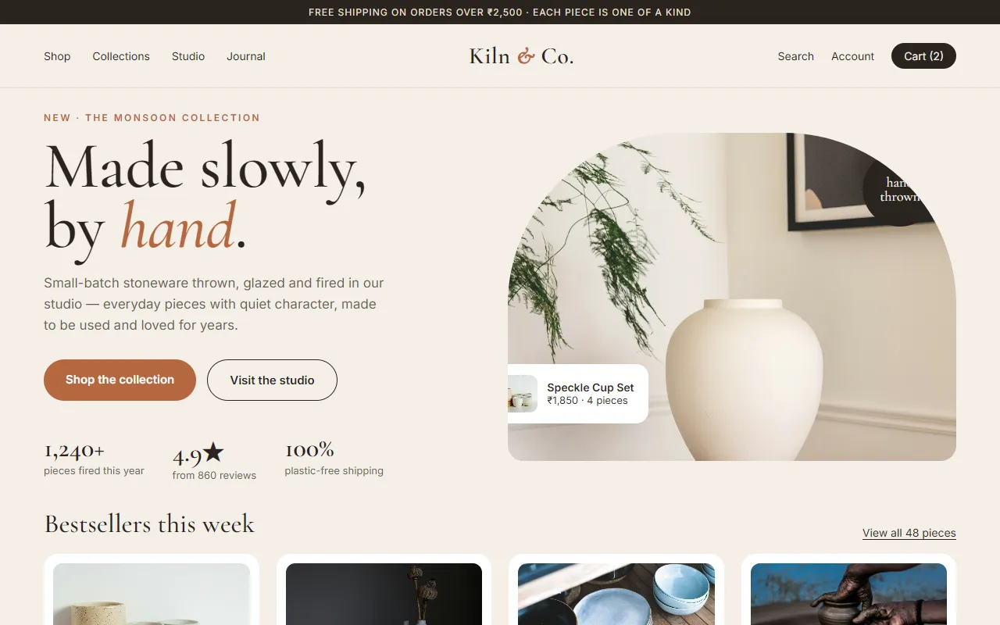

# Anush — The Hand-Drawn Sketchbook Portfolio

A personal portfolio that looks and behaves like an illustrated sketchbook. Visitors explore it **horizontally**, page by page, along a hand-drawn dotted road. A paper plane follows that road as you go, and every border, circle and underline is drawn by code so it looks done by hand.

Built with **HTML5, CSS3 and vanilla JavaScript**. No frameworks, no build step, no dependencies.

---

## Contents

1. [Run it locally](#1-run-it-locally)
2. [Project structure](#2-project-structure)
3. [Edit your profile & copy](#3-edit-your-profile--copy)
4. [Replace your portrait photo](#4-replace-your-portrait-photo)
5. [Edit projects & project images](#5-edit-projects--project-images)
6. [Edit skills, journey & social links](#6-edit-skills-journey--social-links)
7. [Configure the contact form](#7-configure-the-contact-form)
8. [Deploy](#8-deploy)
9. [SEO checklist](#9-seo-checklist)
10. [How it works (for developers)](#10-how-it-works-for-developers)
11. [Credits](#11-credits)

---

## 1. Run it locally

Double-clicking `index.html` works, but a tiny local server is closer to production:

```bash
# any one of these, from the project folder
npx serve .
python -m http.server 8080
```

Then open the printed URL, e.g. `http://localhost:3000` or `http://localhost:8080`.

**Navigating the sketchbook:** scroll the mouse wheel, swipe sideways on touch screens, press <kbd>←</kbd> <kbd>→</kbd> (or <kbd>Home</kbd>/<kbd>End</kbd>), use the arrow buttons in the dock, or jump straight to a chapter from the top navigation. Every page has its own link, e.g. `/#projects` or `/#contact`.

---

## 2. Project structure

```text
├── index.html              ← all content lives here (7 pages / 6 chapters)
├── 404.html                ← sketchy "page not found"
├── robots.txt · sitemap.xml · netlify.toml
├── css/
│   ├── style.css           ← design tokens, components, every page layout
│   ├── animations.css      ← reveals, hand-drawn stroke animations, reduced-motion
│   └── responsive.css      ← laptop → tablet → "pocket sketchbook" (phones)
├── js/
│   ├── config.js           ← ✏️ YOUR DETAILS: email, social links, form backend
│   ├── sketch.js           ← generates the hand-drawn borders/circles/underlines
│   ├── horizontal-scroll.js← horizontal navigation (wheel, keys, swipe, nav, dock)
│   ├── journey-path.js     ← the dotted route + paper plane, and the Journey road
│   ├── interactions.js     ← stickers, sparks, tooltips, tilt, easter eggs, project dialog
│   ├── contact-form.js     ← validation + Formspree / Netlify delivery
│   └── main.js             ← boots everything
└── assets/
    ├── images/             ← portrait, about photo, og-image.jpg
    ├── projects/           ← project screenshots (WebP, 1280px + 640px)
    └── icons/              ← favicon.svg, favicon-32.png, apple-touch-icon.png
```

> `anush-kr-portrait.png` in the project root is the original source photo. The site uses the optimised copies in `assets/images/`, so you can move the original out of the folder before deploying.

---

## 3. Edit your profile & copy

All visible text is in **`index.html`**. Search for these spots:

| What | Where in `index.html` |
|---|---|
| Name in the top bar & cover | `.brand__name`, `.cover__name` |
| Hero headline, role, intro | section `#intro` → `.hero-title`, `.role`, `.lede` |
| About text, philosophy, interests, fun facts | section `#about` |
| Page title, description, social preview | `<head>` (`<title>`, `meta description`, `og:*`, JSON-LD) |

Your **email address and social links** live in `js/config.js` (see §6).

**Colours & fonts:** every colour is a CSS variable at the top of `css/style.css` (`--paper`, `--ink`, `--orange`, …). Fonts load from Google Fonts in the `<head>`: Space Grotesk (display), DM Sans (body), Caveat (handwriting) and Fraunces italic (accents).

---

## 4. Replace your portrait photo

The hero is a collage. A **black-and-white cut-out photo** sits on a tangerine blob, the jacket is "coloured in" with marker strokes, and doodles (crown, sparkles, pencil, heart) go on top.

1. Use a **PNG with a transparent background**, roughly square (the current one is 2108 × 2048).
2. Export two WebP copies with transparency into `assets/images/`:
   - `anush-portrait-900.webp` (900 px wide)
   - `anush-portrait-560.webp` (560 px wide). This one is also used as the mask that keeps the marker colour inside your silhouette.
   Squoosh (https://squoosh.app) works well; keep alpha/transparency enabled.
3. Update the `alt` text on `.portrait__photo` in `index.html`.
4. If your pose is different, nudge the doodles. They live in `.portrait__doodles` and `.portrait__marker`, drawn on a `1000 × 971` grid that matches the photo, where `x=500` is the horizontal centre. Move the crown with its `transform="rotate(...)"` group, and edit the two zig-zag `d=` paths to change where the blue marker colours in.

The "about" polaroid uses `assets/images/sketching-wireframes.webp`. Swap in any 4:5 image you like.

---

## 5. Edit projects & project images

Each project is one `<article class="project …" data-project="…">` in the **Selected projects** sheets (`#projects` and `#more-projects`). Everything about a project, including the details shown in its pop-up case study, lives inside that one article:

```html
<article class="project project--browser" data-project="kiln">
  …          ← card image
  <p class="project__cat">…</p>                      ← category label
  <h3 class="project__title">Kiln &amp; Co.</h3>      ← title
  <p class="project__desc">…</p>                     ← short description
  <ul class="tags">…</ul>                            ← technologies
  <button data-open-project="kiln">View project</button>
  <template class="project__details">                ← pop-up content
                            ← big image in the pop-up
    <dl class="case__meta">…</dl>                    ← role / timeline / type
    <h3>The challenge</h3><p>…</p> …
    <!-- add a real link when you have one: -->
    <!-- <a class="btn btn--ink case__live" href="https://…" target="_blank" rel="noopener">Visit the live site ↗</a> -->
  </template>
</article>
```

- **`data-project` and `data-open-project` must match.**
- Card styles you can mix and match: `project--browser`, `project--polaroid`, `project--postcard`, `project--cutout`, `project--phone`, `project--blueprint`.
- **Images:** save screenshots as WebP at **1280 × 800** (`name.webp`) plus a **640 × 400** copy (`name-sm.webp`). The phone card uses a tall single screen (`sprout-screen.webp`, about 495 × 1050). Always write a descriptive `alt`.
- The six included projects are **concept projects** with original mockups (the pop-up says so under "Type"). Replace them with your real work when you can.

---

## 6. Edit skills, journey & social links

**Skills (`#toolbox`).** Each tool is one `<li>`:

```html
<li style="--brand:#A259FF">
  <button class="tool" type="button" aria-describedby="tip-figma">
    <span class="tool__icon" aria-hidden="true"><svg><use href="#s-figma"/></svg></span>Figma
    <span class="stars" aria-label="daily driver">★★★</span>
  </button>
  <span class="tool__tip hand" role="tooltip" id="tip-figma">Your note…</span>
</li>
```

- Stars: `★★★` daily driver, `★★<i>★</i>` comfy, `★<i>★★</i>` exploring. Update `aria-label` to match.
- Sticker icons are SVG symbols at the top of `index.html` (`id="s-…"`). Copy one to make a new icon.
- `--brand` sets the colour of the spark burst and the "seen" dot.
- The "peeked at X / 19 tools" counter updates itself when you add or remove tools.
- The large **peel-off stickers** are `<span class="sticker" data-sticker>` elements. Add, remove or move them freely.

**Journey (`#journey`).** Each milestone is one `<li class="milestone …">`, alternating `milestone--up` and `milestone--down`. The road redraws itself through the pins automatically. The included dates, degree, certificate and award are **placeholders**, so replace them with your own.

**Email & social links (`js/config.js`):**

```js
email: 'you@yourdomain.com',
social: {
  linkedin: 'https://www.linkedin.com/in/your-handle/',
  github:   'https://github.com/your-handle',
  dribbble: '',          // empty string hides the link
  instagram: 'https://www.instagram.com/your-handle/',
},
```

Also update the fallback `href`s and the email text in the `#contact` section of `index.html`, so they're right even if JavaScript is off.

---

## 7. Configure the contact form

The form validates every field, shows friendly errors, and **only shows "Message sent!" after the server confirms it**. With no backend configured it says nothing was sent and offers a pre-filled email instead, so it never pretends.

Set the provider in `js/config.js → contactForm`:

### Option A: Formspree (works on any host)
1. Create a free form at https://formspree.io and copy its endpoint, e.g. `https://formspree.io/f/abcdwxyz`.
2. In `js/config.js`:
   ```js
   contactForm: { provider: 'formspree', formspreeEndpoint: 'https://formspree.io/f/abcdwxyz' },
   ```

### Option B: Netlify Forms (when hosting on Netlify)
The form already has `data-netlify="true"`, a `form-name` field and a honeypot. Netlify detects it on deploy.
- On a `*.netlify.app` address, `provider: 'auto'` picks Netlify automatically.
- On a **custom domain**, set `provider: 'netlify'`.
- Submissions appear under **Site → Forms** in the Netlify dashboard, where you can turn on email notifications.

### Local development
On `localhost` with `provider: 'auto'` and no Formspree endpoint, the form runs the honest fallback. That's expected.

---

## 8. Deploy

It's a static site, so upload the folder as-is. No build command.

### Netlify
- **Drag & drop:** https://app.netlify.com/drop, then drop the project folder.
- **From Git:** New site → pick the repo → *Build command:* leave empty → *Publish directory:* `.`
  `netlify.toml` already sets the publish folder and caching headers.

### Vercel
New Project → import the repo → *Framework preset:* **Other** → no build command → *Output directory:* `.` → Deploy.

### GitHub Pages
Push to a repository → **Settings → Pages** → *Source:* deploy from branch `main`, folder `/ (root)`.
Your site is published at `https://<user>.github.io/<repo>/`. All asset paths are relative, so this works. Use Formspree for the form, because Netlify Forms only runs on Netlify.

> After deploying, open the live URL and send yourself a test message through the form.

---

## 9. SEO checklist

The site is live at **https://anumanuel.github.io/anush-portfolio/**, and that URL is already set in:
- `index.html`: `<link rel="canonical">`, `og:url`, `og:image`, `twitter:image`, JSON-LD `url`
- `robots.txt` and `sitemap.xml`
- `404.html` (its links use the `/anush-portfolio/` path)

If you move to a custom domain or another host, search for `anumanuel.github.io/anush-portfolio` and replace it everywhere, and change `/anush-portfolio/` in `404.html` to `/`.

`assets/images/og-image.jpg` (1200 × 630) is the link-preview image. Regenerate it whenever the hero changes.

---

## 10. How it works (for developers)

- **Horizontal storyboard.** `.storyboard` is a horizontal scroll container with `scroll-snap-type: x mandatory`. Each `.scene` is one 100vw page that can scroll vertically when its content is taller than the screen.
- **Wheel input.** `horizontal-scroll.js` turns a vertical wheel or trackpad gesture into one page turn and ignores the inertia tail. It lets a page's own vertical scroll finish first, so nobody gets trapped. Pinch-zoom and horizontal swipes stay native.
- **Keyboard and focus.** Tabbing into another page brings that page into view.
- **Hand-drawn shapes.** Any element with `data-sketch="box|circle|underline"` gets an SVG outline from `sketch.js`: seeded randomness, bowed edges, crossed corners and a lighter second pencil pass, redrawn on resize. Optional attributes: `data-sketch-pad`, `data-sketch-seed`, `data-sketch-passes`, `data-sketch-rough`.
- **The route.** `journey-path.js` builds one continuous dotted road across all pages, with a loop-the-loop at each page turn. The plane's position along it is driven by scroll position, and the road is inked behind the plane.
- **Accessibility.** The site uses semantic sections and one `h1`. It also has:
  - A skip link and visible focus styles.
  - Screen-reader announcements on page change.
  - A native `<dialog>` for case studies (focus is trapped inside and returned on close).
  - Tooltips that work on hover, focus and tap.
  - `prefers-reduced-motion` support: no cover animation, instant transitions, no ambient motion.
- **Without JavaScript.** All content stays visible and readable.

---

## 11. Credits

- Photos inside the concept-project mockups come from **[Unsplash](https://unsplash.com)** under the Unsplash License. The mockups themselves (Kiln & Co., Hallo Studio, Saltwater Stays, Atelier Lune, Sprout, Orbit Analytics) are original designs. All brand names are fictional.
- The "about" photo is from Unsplash.
- Software sticker icons are hand-drawn nods to the tools. They aren't official logos, and all trademarks belong to their owners.
- Fonts: Space Grotesk, DM Sans, Caveat and Fraunces (Google Fonts, SIL Open Font License).
